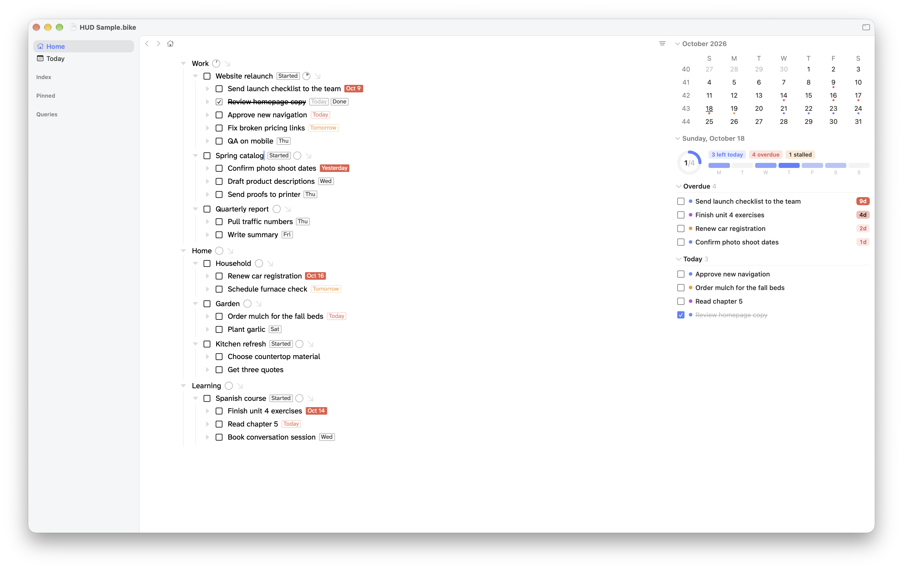

# HUD for Bike

A heads-up display for [Bike 2](https://www.hogbaysoftware.com/bike/) tasks. It sits in the inspector and shows what needs attention today, what's overdue, what's due, the week ahead and work that has stalled. Every item is one click from its row.



HUD is a dashboard, not a planner. Bike holds the work. HUD tells you what's waiting needs your attention.

## Install

1. Download `hud.bkext.zip` from the [latest release](https://github.com/biznachio/bike-hud/releases/latest) and unzip it.
2. Quit Bike, then copy `hud.bkext` into Bike's Extensions folder. Settings › Extensions has a button that reveals it. Remove any older copy of HUD first.
3. Open Bike, show the inspector and choose HUD.

Requires Bike 2 with extension API 0.76 or later.

## What you see

**The band** at the top holds three things:

- A ring that fills as you finish what's due today.
- Tags for what's left today, what's overdue and what's stalled. Click the blue tag to filter the outline to what's still open today, or the red one for overdue rows. Click the orange stalled tag to show or hide the Stalled list.
- One cell for each of the next seven days, starting tomorrow. A cell gets deeper as more is due. Hover a cell for the date and count, and click it to filter the outline to that day.

Once nothing is overdue and today's work is done, the ring closes with a checkmark and the band reads All clear.

**Overdue** lists open rows past their due date, oldest first. The pill shows how many days late each one is, and it gets louder with age: pale at a day or two, stronger at three, solid red after a week. The first five show, with a link to the rest.

**Today** lists everything due today. Finished rows stay in the list, struck through, so you can see progress.

**Stalled** lists rows marked Started that haven't changed in a week or more. A change anywhere inside the row counts, so a project with recent work in its tasks isn't stalled. The list stays hidden until you click its tag.

Click a section title to collapse it. Bike remembers which sections you close.

Each row is one line, with a dot colored by area. Areas are your top-level rows, and colors follow their order in the outline. Hover a row to see its project and area.

## Acting from the HUD

- **Click a row** to select it in the outline. If you're zoomed into a different area, HUD zooms into the row's area first. If a filter is on, HUD clears it so the row isn't hidden. Either way, a Back chip appears at the top to return you to where you were.
- **Click the checkbox** to mark a row done. HUD uses Bike's own task commands, so logs and clocks stay correct.
- **Hover a row** in Overdue or Today and click the calendar button to reschedule it. A menu offers Tomorrow and Next week, each with its date, plus Pick a Date for Bike's own date picker.

## How it reads your outline

HUD works with Bike's built-in data and needs no setup:

- **Due dates** come from Bike's `@due` attribute. A `@due` with no date ("Soon") isn't shown, since it has no day to count from.
- **Done and started** come from Bike's task status.
- **Areas** are your top-level rows. A row's project is its parent.
- **Stalled** uses Bike's row modified dates.

Rows under a done or canceled row are skipped, since a finished project has left your attention. Canceled rows due today don't count toward the ring, and log rows are ignored.

HUD writes to your file only when you act: the done state through Bike's commands, and `@due` when you reschedule. It adds no attributes of its own.

## Building from source

Requires Node.js 18 or later.

```
npm install
npm run build          # builds to out/extensions/hud.bkext
npm run install-ext    # builds and installs into Bike
```

- `src/hud.bkext/app/main.ts` adds the inspector item.
- `src/hud.bkext/dom/hud.tsx` is the panel.
- `src/hud.bkext/dom/lib/model.ts` sorts the outline into overdue, today, the week and stalled work.
- `src/hud.bkext/dom/lib/hud.css` is the styling.
- `src/hud.bkext/tests/` covers the model.

## Credits

Built with Claude. I designed and tested it; Claude wrote the code.

## License

MIT. See [LICENSE](LICENSE).
